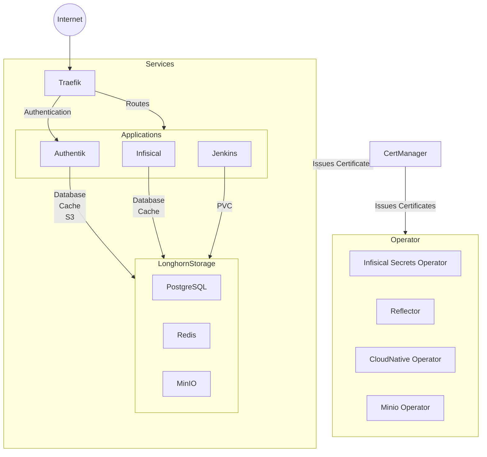

# cluster-config
helm charts, Argo CD applications, and raw manifests for the cluster.

## Layout

| Path | What it holds | Who applies it |
| --- | --- | --- |
| `bootstrap/<env>.yaml` | The root Application `root-<env>`. | You, one time, with `kubectl apply`. |
| `argo/<env>/` | One Application file for each app, and `projects.yaml` (AppProject `platform`). | `root-<env>`, automatically. |
| `apps/<env>/<app>.yaml` | The Helm values for each app in the new layout. | The app's Application (a `$values` source). |
| `apps/<app>/` | The old layout. Each app moves to the new layout in its own story. | Applied by hand in the past. |

`root-<env>` is outside the folder that it reads. A pull request to `argo/<env>/` cannot change or delete it.

## Bootstrap a cluster

Do these steps one time for each cluster. The example uses `dev`.

**Before you start:**

* Argo CD is installed in the `argocd` namespace, and the Argo CD CRDs exist.
* The Infisical operator and the shared `InfisicalAuth` `infisical-prod-universal-auth` (namespace `default`) exist.
* The `charts/argocd` package in GHCR is public. A new cluster must pull it before the GHCR credential exists.

**Steps:**

1. Protect the Argo CD CRDs. If the `Application` CRD is deleted, Kubernetes deletes every Application.

   ```bash
   for crd in applications.argoproj.io applicationsets.argoproj.io appprojects.argoproj.io; do
     kubectl annotate crd $crd argocd.argoproj.io/sync-options=Delete=false,Prune=false --overwrite
   done
   ```

2. Apply the root:

   ```bash
   kubectl apply -f bootstrap/dev.yaml
   ```

3. Make sure that the root is in sync:

   ```bash
   kubectl -n argocd get application root-dev
   ```

   Expected result: `SYNC STATUS` is `Synced` and `HEALTH STATUS` is `Healthy`.

4. In the Argo CD UI, open **Settings > Repositories**. Make sure that `ghcr-raulstechtips-charts-auth` shows **Successful**.

**Sync rules:**

* `root-dev` and the Applications in `argo/dev/` use auto-sync with `selfHeal: true` and `prune: false`.
* If you delete a file in `argo/dev/`, the Application stays. Delete it by hand after a check.
* Do not put `resources-finalizer.argocd.argoproj.io` on an Application in `argo/dev/`. With this finalizer, a deleted Application also deletes all resources of the app (PVCs, databases).

**Rollback:** `kubectl -n argocd delete application root-dev`. `root-dev` has no finalizer, so its child Applications and their resources stay.

## Move an app to the new layout (adoption by name)

Argo CD finds an Application by name and namespace. If you add a file to `argo/dev/` with the same name as a live Application, `root-dev` does not make a second Application. It takes over the live Application and changes its `spec`.

**WARNING:** When you merge the file, the live Application changes at once. Start with manual sync, and turn on auto-sync only after a good manual sync.

1. Record the live Application:

   ```bash
   kubectl -n argocd get application <app> -o yaml > <app>-before.yaml
   ```

2. Add `argo/dev/<app>.yaml`:

   * `metadata.name` is the same as the live Application.
   * `spec.project` is `platform`.
   * `syncPolicy: {}` (manual sync).
   * The annotation `argocd.argoproj.io/sync-options: Delete=false`.
   * No `resources-finalizer`.

3. Add the Helm values in `apps/dev/<app>.yaml`.

4. Open a pull request and merge it.

5. In the Argo CD UI, open `root-dev` and make sure that it is `Synced`. Then open `<app>`. Expected result: `<app>` is `OutOfSync`, because its sync is manual.

6. Click **App Diff**. Examine each change.

   * If a Deployment or StatefulSet changes its `selector`, a plain sync fails. Delete that workload with `kubectl delete <kind> <name> --cascade=orphan`, then sync. The old pods continue to run until the new pods are ready.
   * If a resource shows for prune, stop and examine it.

7. Click **Sync**. Keep **Prune** unchecked.

8. Make sure that all pods are `Running` and the app is `Healthy`.

9. In `argo/dev/<app>.yaml`, change `syncPolicy` to:

   ```yaml
   syncPolicy:
     automated:
       prune: false
       selfHeal: true
   ```

10. Delete the old `apps/<app>/` folder in a separate pull request.

**Rollback:** Revert the pull request from step 4. Then sync `<app>` by hand.

## Kubernetes Cluster Current State Architecture



